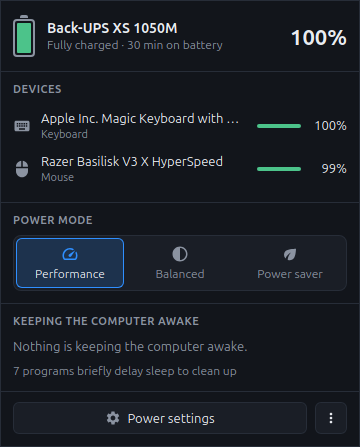

# power-applet

[](https://github.com/arkady-emelyanov/power-applet/actions/workflows/ci.yml)

A tray power applet for Linux: battery levels of every device UPower knows about, the power mode, and what is keeping the computer awake, in one popup. Written as a replacement for Cinnamon's power applet, but works with any StatusNotifierItem tray.

<p align="center">
  <br>
  <sub><b>Popup</b>: what powers the computer, every device's battery, the power mode and what keeps the computer awake.</sub>
</p>

## Why

- Cinnamon's applet re-reads its device list only when the main power source (laptop battery or UPS) changes. A mouse or keyboard battery shown there can be hours or days old. This applet re-reads everything whenever UPower reports any change, after resume, and every 30 seconds regardless.
- A low battery is easy to miss when it happens while you're away or the computer is asleep, and a notification is gone by the time you're back. Here the tray icon carries an amber warning sign for as long as any device is at 20% or below (or UPower considers it low), so you see it whenever you look at the panel.

## Features

- Tray icon: an upright battery filled to the level of what powers the computer (laptop battery or UPS; without one, the lowest peripheral), with a warning sign while any device is low. Charging isn't shown. The tooltip lists every device's level.
- Popup (left click): the main power source with time remaining, every peripheral with its level (low ones highlighted, stale readings marked "updated 3 h ago"), a Performance / Balanced / Power saver switch (power-profiles-daemon), and the programs currently blocking sleep or the screensaver (logind and session manager inhibitors).
- A button for the desktop's power settings (Cinnamon, GNOME, KDE, MATE, Xfce).
- Right click: a small menu with Power settings and Quit.
- Starts at login (can be turned off in the popup's ⋮ menu).

## Install

```
curl -Lo ~/.local/bin/power-applet https://github.com/arkady-emelyanov/power-applet/releases/latest/download/power-applet-x86_64-linux
chmod +x ~/.local/bin/power-applet
power-applet &
```

It needs GTK 3 and WebKitGTK 4.1 (Ubuntu 22.04+, Linux Mint 21+: `sudo apt install libwebkit2gtk-4.1-0`), UPower, and optionally power-profiles-daemon for the power mode switch. On first start it adds itself to the application menu and to the login items, and installs its tray icons into `~/.local/share/icons/hicolor`.

On Cinnamon, remove the built-in Power Manager applet from the panel (right click it, "Remove") so you don't have two battery icons.

## Develop

```
sudo apt install libgtk-3-dev libwebkit2gtk-4.1-dev
cargo run
```

Set `RUST_LOG=power_applet=debug` for detailed logs, including every snapshot read from D-Bus. `cargo test -- --ignored dump_snapshot --nocapture` prints what the applet reads from your system.
